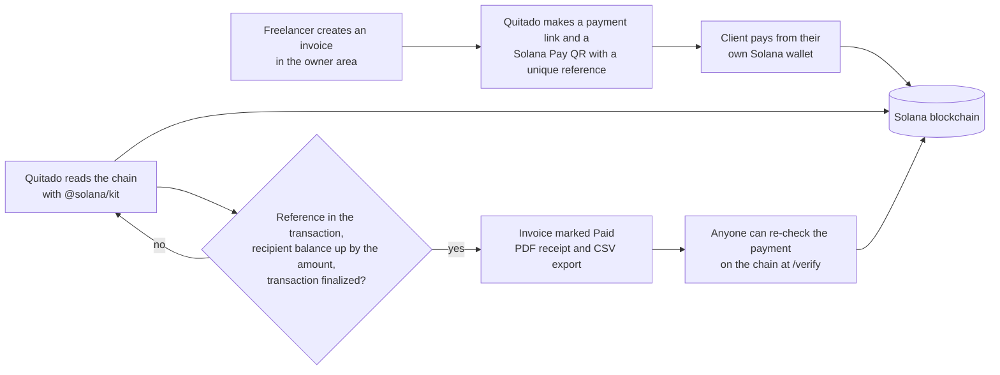

# Quitado

Open-source, non-custodial USDC/USDT invoicing on Solana for Brazilian freelancers.

> **Status: early development, not ready for production use.** The core, storage, payment detection
> and the web app work and are tested (including against a real devnet). The owner can download
> the paid invoices as a CSV file for an accountant (amounts in the token, no tax calculation). The
> Brazilian tax layer (exchange-rate references, tax rules) is planned and not built yet.

[](https://railway.com/deploy/quitado)

You can run your own instance on Railway with one click, or on any server with Docker (see below).

## At a glance

- **What it is:** a way for a freelancer paid from abroad to bill in USDC or USDT on Solana. You send
  a link, the client pays from their wallet, the invoice marks itself as paid and a PDF receipt is
  issued. Quitado never holds the money or the keys and charges no fee. It runs on Solana mainnet.
- **New in the Dev3pack hackathon (27 to 29 November 2026):** a CSV export of paid invoices for the
  accountant, a public page that re-checks a payment on the Solana blockchain, and a link-preview
  image for the site. The full list, with its pull requests, is in
  [During the hackathon](#during-the-hackathon-27-to-29-november); the state before it is the git
  tag [`pre-hackathon`](https://github.com/quitado-app/quitado/tree/pre-hackathon).
- **See it working:** the home page is [quitado.finance](https://quitado.finance). The author's own
  instance runs at `pay.quitado.finance`: its owner area needs the owner's secret, but payment pages
  and the `/verify` page are public. To run your own in a few minutes, use the Railway button above
  and the [step-by-step guide in Portuguese](docs/pt-BR/railway.md).
- **Honest status:** early stage. There are no customers yet, and the Brazilian tax layer is planned,
  not built.

## What it is

You create an invoice, send your client a link, and the client pays from any Solana wallet by
scanning a QR code. The money goes straight to your own wallet: Quitado never holds funds or private
keys, takes no fee, and needs no account, only a wallet address. The app notices the payment on
chain and marks the invoice as paid.

You run your own instance (one owner per instance). There is no hosted service.

## How it works



Payment detection looks at what actually happened on chain instead of trusting a request: the
transaction must cite the invoice's unique reference (a real Solana public key whose private half is
thrown away), it must not have failed, and the recipient's balance of that token must have risen by at
least the invoice amount, at the `finalized` commitment. A transfer typed in by hand, without the
reference, never marks an invoice as paid. Details: [payment-detection.md](docs/payment-detection.md).

## Quick start

**Run your own instance** (Docker; Railway needs no commands, see the button above):

```bash
git clone https://github.com/quitado-app/quitado.git
cd quitado
cp .env.example .env     # set QUITADO_RECIPIENT (your wallet's public address) and QUITADO_ACCESS_SECRET
docker compose up -d     # the app listens on 127.0.0.1:3000; open /admin and sign in with the secret
```

Put a reverse proxy with TLS in front of it to serve it to the internet, and set `QUITADO_BASE_URL`
(see [docs/deploy.md](docs/deploy.md)). Step-by-step guides in Portuguese:
[Railway](docs/pt-BR/railway.md) and [quick guide](docs/pt-BR/guia-rapido.md).

**Develop** (Node.js 24 or newer):

```bash
npm ci                   # install, from the lockfile
npm run build            # compile the TypeScript workspaces
npm test                 # the unit tests; `npm run check` also runs format, lint and types
npm start                # starts the server; reads .env when it exists
```

The main settings, all in [`.env.example`](.env.example): `QUITADO_RECIPIENT` (the wallet that receives
payments: a public address, Quitado never holds a private key), `QUITADO_ACCESS_SECRET` (at least 20
characters, to sign in), `QUITADO_CLUSTER` (`mainnet-beta`, or `devnet` with `QUITADO_ASSETS`),
`QUITADO_BASE_URL`, `QUITADO_RPC_URL` and `QUITADO_UTC_OFFSET_MINUTES` (`-180` for Brazil).

## Where the Solana parts live

| What                                               | Where                                                                                    |
| -------------------------------------------------- | ---------------------------------------------------------------------------------------- |
| Solana Pay transfer request (link and QR)          | [`packages/server/src/web/solana-pay.ts`](packages/server/src/web/solana-pay.ts)         |
| Unique payment reference (an ed25519 public key)   | [`packages/server/src/web/ids.ts`](packages/server/src/web/ids.ts)                       |
| Reading the chain with `@solana/kit`               | [`packages/server/src/detection/chain.ts`](packages/server/src/detection/chain.ts)       |
| The rule that decides "this transaction paid it"   | [`packages/server/src/detection/evaluate.ts`](packages/server/src/detection/evaluate.ts) |
| Polling open invoices and settling them            | [`packages/server/src/detection/worker.ts`](packages/server/src/detection/worker.ts)     |
| Re-checking a payment at `/verify`                 | [`packages/server/src/web/verify.ts`](packages/server/src/web/verify.ts)                 |
| USDC and USDT mints, exact amounts (integer units) | [`packages/core/src/assets.ts`](packages/core/src/assets.ts), `money.ts`                 |
| Invoices stored in SQLite (`node:sqlite`)          | [`packages/server/src/storage/`](packages/server/src/storage/)                           |
| PDF receipt (own writer, no dependency)            | [`packages/server/src/receipt/`](packages/server/src/receipt/)                           |
| CSV export for the accountant                      | [`packages/server/src/web/csv.ts`](packages/server/src/web/csv.ts)                       |
| A real devnet payment, end to end                  | [`packages/spike-devnet/`](packages/spike-devnet/) and `detection/devnet.e2e.test.ts`    |

Quitado deliberately deploys **no Solana program of its own**: payments go straight from the payer's
wallet to the owner's, so there is nothing to hold on chain. It builds on the existing SPL Token
program through USDC and USDT.

| Address                                            | What                                    |
| -------------------------------------------------- | --------------------------------------- |
| [quitado.finance](https://quitado.finance)         | Home page                               |
| [pay.quitado.finance](https://pay.quitado.finance) | The author's own instance, on mainnet   |
| `EPjFWdd5AufqSSqeM2qN1xzybapC8G4wEGGkZwyTDt1v`     | USDC mint on Solana mainnet             |
| `Es9vMFrzaCERmJfrF4H2FYD4KCoNkY11McCe8BenwNYB`     | USDT mint on Solana mainnet             |
| `TokenkegQfeZyiNwAJbNbGKPFXCWuBvf9Ss623VQ5DA`      | SPL Token program, which both mints use |

## Hackathon: what was done before and what is new

This project was started on 1 November 2026, before the Dev3pack Global Hackathon (27 to 29
November 2026). The state at the start of the hackathon is the git tag
[`pre-hackathon`](https://github.com/quitado-app/quitado/tree/pre-hackathon) (26 November
2026, 81 commits, 40 merged pull requests, 358 tests).

### Before the hackathon (1 to 26 November)

- **Core:** the invoice domain in integer base units (no rounding errors), USDC and USDT.
- **Storage:** SQLite through Node's built-in `node:sqlite`, with migrations and atomic settlement.
- **Payment detection:** a Solana Pay reference plus the change in the recipient's token balance,
  checked at `finalized`; tested against a real devnet.
- **Web app:** owner panel, public payment page with QR code and "open in wallet", payment
  receipt as a PDF (own writer, no extra dependency), usage statistics, Portuguese and English,
  accessibility work.
- **Running it:** Docker, a Railway template with a one-click button, and step-by-step guides in
  Portuguese, including one for people new to Solana.
- **Live:** an instance on Solana mainnet at https://pay.quitado.finance and the home page at
  https://quitado.finance. The author made real test payments in USDC and USDT on mainnet.
- **Quality:** an independent security review (findings fixed), CI with secret scanning, and the
  guides revised after questions from the first beta testers.

### During the hackathon (27 to 29 November)

The hackathon work started at the git tag `hackathon-start` (27 November 2026, 12:00 Brasília time).
Everything committed after it is the work done during the hackathon:
[compare `hackathon-start...main`](https://github.com/quitado-app/quitado/compare/hackathon-start...main).
This list is updated as each piece ships, newest last.

- **27 Nov: CSV export of paid invoices for the accountant**
  ([#46](https://github.com/quitado-app/quitado/pull/46)). An owner-only `/admin/export/paid.csv`,
  with an optional year and month, linked from the stats page. It opens in Excel with accents and
  columns in place (UTF-8 with a byte order mark; `;` and a decimal comma in Portuguese), amounts are
  exact decimals built from integer base units, and cells are protected against spreadsheet formula
  injection. No tax calculation, no conversion to reais, no outside calls, no new dependency.
- **27 Nov: a spreadsheet tip next to the CSV button**
  ([#47](https://github.com/quitado-app/quitado/pull/47)). Excel shows `#####` when a date column is
  too narrow, which looks like an error; the stats page and the docs now say the file is fine and how
  to widen the column. Found by trying the export in Excel.
- **27 Nov: a link-preview image for the home page**
  ([#49](https://github.com/quitado-app/quitado/pull/49)). Sharing the site on X, LinkedIn or WhatsApp
  showed a grey card with no image. There is now a 1200x630 PNG per language (Portuguese and English),
  drawn with the site's own mark, served by the app itself, and the page has the `og:image` and
  `twitter:card` tags. A test checks the tags and that the files are real 1200x630 PNGs.
- **27 Nov: a public page to check a payment on the blockchain**
  ([#50](https://github.com/quitado-app/quitado/pull/50)). On `/verify`, anyone can paste a transaction
  signature and the page re-reads that transaction from the Solana network (at `finalized`), with the
  same rules the payment detection uses, and shows the amount, token, recipient, payer and block time
  that the chain itself reports. It is linked from the paid payment page, shows no client data, and
  answers "not confirmed" when the chain does not show the recorded payment. Only signatures this
  instance recorded reach the network, with their own rate limit, so it cannot be used to spend the
  owner's RPC credits. Checked on the live instance against the author's two real mainnet test
  payments (0.10 USDC and 0.10 USDT).
- **27 Nov: a devnet section in the Portuguese Railway guide**
  ([#53](https://github.com/quitado-app/quitado/pull/53)). A beta tester asked whether he could try
  Quitado without real money, so the guide now explains how to use the Solana devnet, with test USDC
  from Circle's faucet and the devnet USDC address that Circle lists in its own documentation. It says
  plainly that this path is less tested than mainnet.

### What does not exist

There are no users yet beyond the author: the first beta testers are only now starting. There is
no hosted service and no tax layer. The receipt is not a nota fiscal.

## Documentation

- [Web app: running it, access and security](docs/web.md)
- [Guia rápido em português](docs/pt-BR/guia-rapido.md)
- [Quitado na Railway, passo a passo (português)](docs/pt-BR/railway.md)
- [Deploying with Docker, and the mainnet checklist](docs/deploy.md)
- [A Railway template for Quitado](docs/railway-template.md)
- [Payment detection](docs/payment-detection.md)
- [Payment receipts (PDF)](docs/receipts.md)
- [Devnet spike: what we verified about Solana Pay](docs/spike-devnet.md)
- [Security policy](SECURITY.md)

## License

[Apache-2.0](LICENSE)
